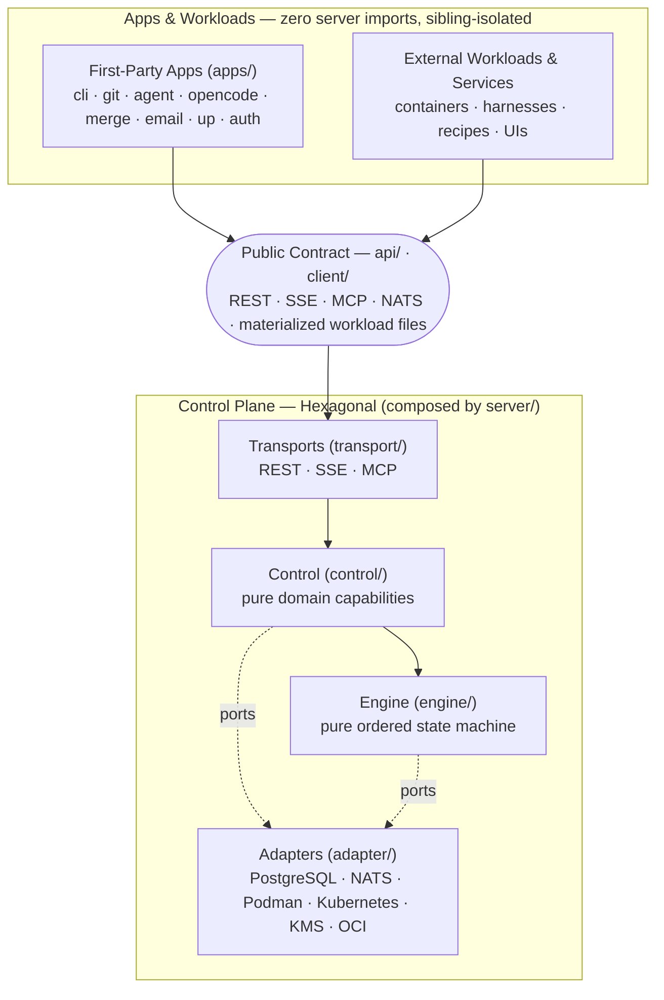

# S01 — Architecture and contracts

Source: [architecture](../../KODEMA.md#1-product-and-architecture), [implementation discipline](../../KODEMA.md#implementation-discipline).

## 1. Architectural shape and ownership

Kodema uses a **two-sided (hourglass) architecture** joined at a narrow public contract (`api/` and `client/`), with a **hexagonal Control Plane** on the inside and isolated **Apps & Workloads** on the outside:

- **Execution Engine (`internal/engine`):** executes admitted ordered work. Pure, deterministic, stdlib-only state machine with zero knowledge of tasks, roles, Git, HTTP, SQL, NATS, identity, or agents. Task snapshot bytes reach preparation as opaque data; the Engine never interprets their fields.
- **Control Capabilities (`internal/control`):** pure domain rules, authorization, verification, task/request lifecycles, immutable KV, secret custody, tokens, event publication intent, and push triggers. Zero infrastructure I/O (`net`, `database/sql`, `os/exec`, `crypto/tls`).
- **Adapters & Transports (`internal/adapter`, `internal/transport`):** concrete PostgreSQL/memory persistence, Process/Podman/Kubernetes runtimes, NATS/KMS/OIDC/OCI integrations, and one shared operation router behind thin REST and MCP edges. Only Control Plane adapters access the factory database.
- **Composition (`internal/server`, `cmd/kodema`):** one explicit Control Plane composition root and CLI dispatch entrypoint.
- **Public Contract (`api`, `client`):** stdlib-only wire DTOs/schemas (`api`) and the public REST/SSE/NATS Go client (`client`).
- **Apps & Workloads (`internal/apps`, plus external containers/services):** independent first-party programs (`cli`, `git`, `agent`, `opencode`, `merge`, `email`, `up`, `auth`) and third-party workloads/services. Even when linked into the single `kodema` binary, apps use `api`/`client` contracts only, never import Control Plane or Engine internals, and remain isolated from sibling apps (sharing only `api`, `client`, neutral primitives, and a minimal `internal/apps/kit` helper layer).

## 2. Package layout

The repository mirrors the hexagonal Control Plane and `apps/` boundary directly under `internal/` so `ls internal/` reflects the enforced import rings:

| Ring | Paths | Responsibility |
|---|---|---|
| Neutral & contract | `api`, `client`, `internal/id`, `internal/fault`, `internal/docs` | Public DTOs/schemas, Go client, typed IDs, error taxonomy, embedded docs |
| Engine | `internal/engine`, `internal/engine/{definition,flow,script,reconcile,testkit}` | Root execution types, pure definition validation, ordered reducer, fail-fast script rendering, deterministic reconciler, fakes |
| Control | `internal/control/{tenancy,resource,identity,token,service,authorize,verify,pipeline,execution,request,task,inbox,kv,event,receipt,trigger,secret,workspace,log,store,gateway,mcpproxy}` | Pure domain capabilities, authorization/verification, store/secret/workspace contracts, optional in-process gateways |
| Adapter | `internal/adapter/store/{memory,postgres,storetest,units/*}`, `internal/adapter/runtime/{container,process,podman,kube}`, `internal/adapter/integration/{keys,nats,oidc,platform,registry}` | Concrete persistence and store fixtures, process/Podman/Kubernetes runtimes, infrastructure integrations |
| Transport | `internal/transport/{ops,httpapi,mcp}` | Single operation router and thin REST, SSE, and MCP edges |
| Server | `internal/server` (`bridges`, `drivers`, `migrate`, `ops`) | Control Plane composition root, bridges, driver wiring, migrations, operation registration |
| Apps | `internal/apps/{cli,git,agent,opencode,merge,email,up,auth}`, `internal/apps/kit/{principal,session,skill,sandbox,servicekit}` | Independent first-party programs speaking public contracts only (`cli` owns its `sessionlock`/`userlandfs` subpackages), plus shared app helpers in `kit/` |
| Installation & examples | `internal/installation`, `deploy`, `examples` | Config/preflight, Helm/OpenTofu, reference delivery recipes |

`api` contains public DTOs/schemas only. `internal/installation` is configuration and preflight logic, not a product layer or alternate composition root.

## 3. Import rules

| Importer | Allowed | Forbidden |
|---|---|---|
| `api`, `id`, `fault`, `docs` | Standard library | Product implementations, transport clients |
| `engine` | Standard library, `id`, `fault`, acyclic `engine` packages | `api`, `control`, `adapter`, `transport`, `server`, `apps`, infrastructure stdlib/clients |
| `control` | `engine`, `api`, neutral packages, consumer-owned ports, approved YAML parser | Concrete `adapter` packages, `transport`, `server`, `apps`, infrastructure I/O (`database/sql`, `net`, `os/exec`, `crypto/tls`) |
| `adapter` | Consumed `engine`/`control`/`api` contracts, neutral packages, approved technology dependencies | Bypassing another capability's port; `server`, `apps` |
| `transport` | `api`, `engine`, `control`, neutral packages, router contract | `database/sql`, concrete `adapter` packages, duplicate authorization/lifecycle rules, `apps` |
| `server` / `cmd` | Completed packages needed for its process | Shared mutable global registries, `init` side effects |
| `apps/<app>` | `api`, `client`, neutral packages, `apps/kit`, own subpackages | `engine`, `control`, `adapter`, `transport`, `server`, `installation`, sibling `apps/<other>` packages |

Consumer-owned interfaces live with the consumer; no universal `Repository`, service locator, generic event engine, or global `contracts` god-package. A provider can implement several small interfaces without depending on a consumer implementation. Shared declarations must form an acyclic graph.

## 4. Port contract shape

Every effectful port specifies input identity/version, success evidence, ambiguous failure, idempotency, cancellation, and ownership of retries. `context.Context` is first on blocking calls. Return a structured observation, not a boolean that collapses uncertainty.

Engine state ports must support load, compare-and-commit transitions/intents, and scanning due/unfinished work. The commit contains expected execution/action versions, output changes, cancellation/deadline effects, and credential-invalidation intent. Control Plane adapters apply audit, events, and token changes atomically without injecting identity policy into the Engine.

Control Plane transaction ports express **complete commit units**, such as `AskTask`, `ReplyAndAdmit`, or `ResolveRequest`—never independently committing `SaveTask` and `CancelExecution` calls. Capability transitions run with authoritative locked/versioned state and an explicit current time. The persistence adapter stores facts; it is not a second state machine.

External calls occur outside database transactions. Read/resolve external input first, then validate relevant versions and authority when committing. Persist external-effect intent before starting it; retry through observation, not guessed success.

## 5. Errors and determinism

Required error classes: invalid input, unauthenticated, forbidden, not found, version conflict, changed idempotency content, expired/deadline, unsupported capability, dependency unavailable, uncertain external effect, and internal failure. Stable public codes map consistently across REST/MCP; private causes never expose tokens or secrets.

Inject clock, ID generation, randomness, external clients, and command execution at real boundaries. Production randomness is cryptographic. Runtime errors distinguish a proven pre-effect refusal from a lost post-effect response. Business terminal state and pending cleanup are separate fields.

## 6. Verification boundary

Pure Engine and Control packages are verified with deterministic fakes and zero external processes. Adapters are verified first against contract fixtures over faked drivers, then against real PostgreSQL, NATS, Podman, Kubernetes, Git, and KMS infrastructure. Every package documents its owned invariant, its ports, and the real-infrastructure proof required; unit tests alone never claim PostgreSQL atomicity, container isolation, or end-to-end authority.
