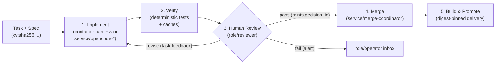

# Kodema Examples

A curated, contract-tested catalog of Kodema pipelines, Agentic SDLC patterns,
delivery recipes, and context-repository knowledge files.

Every pipeline YAML in this directory is decoded against Kodema's real admission
parser, checked for digest-pinned container images (`@sha256:...`), verified
against real `kodema` CLI subcommands, and scanned for credential leaks by
`go test ./examples/...`.



## Quick guide: which pattern should I use?

| Need | Start here | Why |
|---|---|---|
| Understand the simplest task-free run | [`pipelines/plain.yaml`](pipelines/plain.yaml) | Ordinary container action with zero inputs or tasks. |
| Run a coding agent in an ephemeral container | [`pipelines/external-harness.yaml`](pipelines/external-harness.yaml) | Uses `kodema harness exec -- <cmd>` (rotation-safe loopback LLM proxy, zero CA boilerplate, active budgets). |
| Pause for human sign-off (keep `/workspace`) | [`pipelines/planned-review.yaml`](pipelines/planned-review.yaml) | Planned `request: role/reviewer` gate with immutable subject bindings. |
| Ask a human an unplanned question mid-run | [`pipelines/task-handoff.yaml`](pipelines/task-handoff.yaml) | Persists durable context, calls `task.ask` (cancelling the run), resumes in a fresh execution after `task.reply`. |
| Run a full multi-stage Agentic SDLC | [`agentic-sdlc/README.md`](agentic-sdlc/README.md) | End-to-end Patterns A (in-container), B (OpenCode worktree service), and C (polyglot MCP sandboxes). |
| Build, test, promote, and roll back OCI images | [`delivery/README.md`](delivery/README.md) | Digest-pinned external-registry delivery without rebuilding on promote, retry, or rollback. |
| Share company/project rules and skills with agents | [`knowledge/README.md`](knowledge/README.md) | Markdown conventions and slug-named skills pulled via `kodema context pull`. |

---

## Catalog

### 1. Core pipeline primitives ([`pipelines/`](pipelines/))

| Pipeline | Demonstrates | Flow |
|---|---|---|
| [`plain.yaml`](pipelines/plain.yaml) | Task-free container work, pipeline `env`, unshadowable `KODEMA_*` vars | `inspect` |
| [`push-test.yaml`](pipelines/push-test.yaml) | `on.push` exact-ref Git trigger and exact push input set | `test` |
| [`planned-review.yaml`](pipelines/planned-review.yaml) | Planned `role/reviewer` gate referencing an earlier output | `build` → `review` |
| [`task-handoff.yaml`](pipelines/task-handoff.yaml) | Unplanned conversation ask (`task.read` + `task.ask`) with durable commit/digest refs | `persist` → `ask` |
| [`service-response.yaml`](pipelines/service-response.yaml) | Delegating a request action to an explicit `service/<id>` with declared outputs | `respond` |
| [`external-harness.yaml`](pipelines/external-harness.yaml) | In-container coding agent wrapped with `kodema harness exec`, caches, and LLM budgets | `prepare` → `harness` |

### 2. Multi-stage & Agentic SDLC workflows ([`agentic-sdlc/`](agentic-sdlc/README.md))

| File | Pattern | Highlights |
|---|---|---|
| [`implement-stage.yaml`](pipelines/implement-stage.yaml) | Two-stage task (Stage 1) | `plan` → `code` → `push` with `completes_task: false` |
| [`integrate-stage.yaml`](pipelines/integrate-stage.yaml) | Two-stage task (Stage 2) | `rebase` → `build` → `review` → `merge` (`merge_coordinator`) → `deploy` |
| [`pattern-a-implement.yaml`](agentic-sdlc/pattern-a-implement.yaml) | Pattern A (Stage 1 of 3) | In-container `kodema harness exec`, KV spec/summary, caches, budgets |
| [`pattern-a-verify-review.yaml`](agentic-sdlc/pattern-a-verify-review.yaml) | Pattern A (Stage 2 of 3) | Deterministic `go test -race`, KV test report, 3-way `role/reviewer` gate |
| [`pattern-a-merge.yaml`](agentic-sdlc/pattern-a-merge.yaml) | Pattern A (Stage 3 of 3) | Cross-execution `decision_id` handoff to `service/merge-coordinator` |
| [`pattern-b-worktree-sdlc.yaml`](agentic-sdlc/pattern-b-worktree-sdlc.yaml) | Pattern B (Option 1) | Persistent per-project OpenCode service (`--mode worktree`, no `engineer` role) |
| [`pattern-c-sandbox-polyglot.yaml`](agentic-sdlc/pattern-c-sandbox-polyglot.yaml) | Pattern C (Option 2) | OpenCode service (`--mode sandbox`) + ephemeral Go & Node `kodema sandbox serve` pods |
| [`opencode-sandbox-values.yaml`](agentic-sdlc/opencode-sandbox-values.yaml) | Kubernetes isolation | Helm values overlay for tenant/project-scoped OpenCode + sandbox NetworkPolicies |

### 3. Delivery, unprivileged OCI builds & promotion ([`delivery/`](delivery/README.md))

| Pipeline | Stage | Highlights |
|---|---|---|
| [`build.yaml`](pipelines/build.yaml) | Build | Publishes bytes to external registry and emits digest-pinned `image` output |
| [`oci-build.yaml`](pipelines/oci-build.yaml) | Unprivileged OCI build | Rootless Kaniko `Containerfile` build with no Docker/Podman socket or `/dev/fuse` |
| [`test.yaml`](pipelines/test.yaml) | Test | Consumes forwarded `image` digest without rebuilding |
| [`promote.yaml`](pipelines/promote.yaml) | Promote | Writes deploy candidate → `role/reviewer` approval on `deploy-repo-1` → integrates |
| [`rollback.yaml`](pipelines/rollback.yaml) | Rollback | Promotes an older digest through the exact same `deploy-repo-1` approval gate |
| [`readiness.yaml`](pipelines/readiness.yaml) | Readiness | Observes post-rollout health explicitly and emits a `ready` output |

### 4. Context-repository knowledge ([`knowledge/`](knowledge/README.md))

| File | Purpose |
|---|---|
| [`knowledge/README.md`](knowledge/README.md) | Context repository structure and `kodema context pull` / `list` / `show` usage |
| [`knowledge/conventions.md`](knowledge/conventions.md) | Durable project-wide rules (references, KV keys, secret hygiene) |
| [`knowledge/skills/build-and-test.md`](knowledge/skills/build-and-test.md) | Reusable skill for digest-pinned image builds and tests |
| [`knowledge/skills/promote-and-verify.md`](knowledge/skills/promote-and-verify.md) | Reusable skill for promotion, rollback, and readiness checks |

### 5. Admission negative fixtures ([`testdata/invalid/`](testdata/invalid/))

Minimal single-fault YAML documents proving Kodema's admission parser refuses
unsupported constructs (`unknown-field`, `forward-reference`,
`undeclared-input-reference`, `both-kinds`, `push-glob-ref`, `reserved-env`,
`reserved-secret`, `interpolated-subject`, `duplicate-action`, `no-actions`,
`yaml-alias`) with `invalid_input`.

---

## Conventions & verification

- **Immutable image references:** Shipped pipeline examples pin every container
  image to `registry.example.com/.../@sha256:<64-hex>` to demonstrate digest
  pinning. Replace image references with digests in your own registry (or a
  local image pulled with `podman pull`) before running on `kodema up`.
- **Secrets by name only:** Examples declare secret names in `secrets: [...]`
  and never embed credential values. LLM provider keys stay in Kodema's control
  plane (`kodema secret set`) and are never mounted into containers.
- **Run the example contract suite locally:**

```sh
go test -v ./examples/...
```

## Further reading

- [Quickstart: local Kodema with `kodema up`](../docs/runbooks/quickstart.md)
- [Native LLM proxy, coding harnesses, and agentic services](../docs/runbooks/llm-proxy-harnesses.md)
- [Unprivileged OCI container builds & workload limits](../docs/runbooks/unprivileged-oci-builds.md)
- [Documentation index](../docs/README.md)
