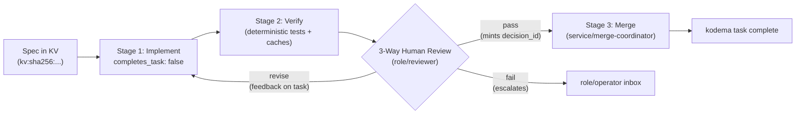

# Agentic SDLC Examples

A tested, end-to-end suite of Agentic SDLC pipelines and Kubernetes
NetworkPolicy values demonstrating all three Kodema agent execution patterns —
starting from an interactive user harness acting as **PM & Orchestrator** on
`kodema up` and graduating unchanged to 24/7 automation.

Every pipeline YAML here is decoded and validated against Kodema's real
admission parser, service subject contracts, and a hermetic 3-stage lifecycle
by [`examples/agentic_sdlc_test.go`](../agentic_sdlc_test.go).



## Comparing the three patterns

| Dimension | Pattern A — In-container harness | Pattern B — Option 1 worktree service | Pattern C — Option 2 sandbox mode |
|---|---|---|---|
| **Pipelines** | [`pattern-a-implement.yaml`](pattern-a-implement.yaml), [`pattern-a-verify-review.yaml`](pattern-a-verify-review.yaml), [`pattern-a-merge.yaml`](pattern-a-merge.yaml) | [`pattern-b-worktree-sdlc.yaml`](pattern-b-worktree-sdlc.yaml) | [`pattern-c-sandbox-polyglot.yaml`](pattern-c-sandbox-polyglot.yaml) + [`opencode-sandbox-values.yaml`](opencode-sandbox-values.yaml) |
| **Execution model** | Ephemeral container Job per stage (`kodema harness exec`) | Persistent per-project OpenCode v2 service (`--mode worktree`) | Persistent OpenCode v2 reasoning pod (`--mode sandbox`) + ephemeral `kodema sandbox serve` Jobs |
| **Session persistence** | Stateless per action (handoffs via Git + KV) | Durable `task_id -> opencode_session_id` across turns | Durable `task_id -> opencode_session_id` across turns |
| **Toolchains** | Any custom harness image | Local toolchain inside the OpenCode service host/pod | Stock upstream images per stage (`golang:1.24`, `node:22`, `python:3.12`) |
| **Service-account roles** | None (execution token `kodex.*` only) | **No `engineer` role** (`roles: []` + `RW+ refs/heads/work/`) | **Requires `engineer` role** (inline sandbox `pipeline.start` / `execution.cancel` / ephemeral token secrets) |
| **Concurrency** | Unlimited (Kubernetes Jobs / Podman) | `--max-concurrency 1` (stock `opencode serve`); `--max-concurrency > 1` with `--per-turn-proxy-routing` + `X-OpenCode-Session` plugin | `--max-concurrency 1` per OpenCode v2 server instance |
| **Best fit** | Maximum isolation, zero long-lived agent pods | Fast iterative multi-turn coding on one repo | Polyglot repos & strict blast-radius separation on Kubernetes |

---

## Starting point: your user harness as PM & Orchestrator

Before running any 24/7 service, connect your everyday AI harness (**Claude
Code**, **Codex**, **OpenCode**, or **Cursor**) to a local Podman Kodema
instance with zero Kubernetes setup and zero local app builds:

```sh
kodema up
source ~/.kodema/instances/default/env.sh
printf '%s' "$ANTHROPIC_API_KEY" | kodema secret set ANTHROPIC_API_KEY --stdin   # or OPENAI_API_KEY / OPENCODE_API_KEY, or --value-file <path>
kodema mcp install claude                # or codex, opencode, cursor
kodema docs install --target agents      # or claude, opencode, all
```

Collaborate with your harness over MCP to store specs in KV (`kv_put`), apply
these pipelines (`pipeline_apply`), create and drive multi-stage tasks
(`task_create`, `task_start`, `execution_inspect`, `execution_logs_read`),
iterate through 3-way review gates (`execution_request_resolve` with `pass`,
`revise`, or `fail`), and close tasks (`task_complete`).

---

## Pattern A: In-container harness SDLC

Best when you want each coding or verification stage to run as an isolated,
stateless container Job with zero long-lived agent pods:

1. **Stage 1 — Implement ([`pattern-a-implement.yaml`](pattern-a-implement.yaml)):**
   - Wraps the agent with `kodema harness exec -- opencode run ...` (rotation-safe
     loopback LLM proxy, zero CA boilerplate, automatic OpenCode v2
     `OPENCODE_CONFIG_CONTENT`, zero raw provider keys in containers).
   - Mounts non-authoritative named caches (`caches: [go-mod, go-build]`) at
     `/kodema/cache/go-mod` and `/kodema/cache/go-build`.
   - Enforces active execution and action LLM budgets (`budget.max_tokens` and
     `budget.max_cost_usd`).
   - Reads the spec from KV (`kodema kv get`) and publishes a diff summary to KV
     (`kodema kv put`), setting `completes_task: false` so the task stays `open`.
2. **Stage 2 — Verify and 3-way review ([`pattern-a-verify-review.yaml`](pattern-a-verify-review.yaml)):**
   - Runs deterministic `go test -race ./...` in a separate toolchain image and
     uploads the report to KV (`report_key`).
   - Waits at `request: role/reviewer`:
     - `kodema approve <exec>` (`pass`) mints an immutable **`decision_id`**.
     - `kodema revise <exec> --reason "..."` (`revise`) appends feedback to the
       task conversation and keeps the task `open` without escalating to
       `role/operator`.
     - `kodema reject <exec> --reason "..."` (`fail`) fails the execution and
       alerts `role/operator`.
3. **Stage 3 — Serialized merge ([`pattern-a-merge.yaml`](pattern-a-merge.yaml)):**
   - Passes `decision_id` to `service/merge-coordinator`
     (`kodema services --kind merge_coordinator`), which serializes pushes to
     `target_ref` and forwards `-o kodema.decision_id=<id>` (refusing with
     base-moved if `target_ref` advanced past `base`). When a repository enables
     `option approve-rebase.<ref> = disjoint`, `kodema git serve` also supports
     `-o kodema.approved_base=<sha> -o kodema.approved_candidate=<sha>`
     (optionally paired with `-o kodema.decision_id=<id>`) for pushing
     executions or custom rebase-aware merge services.
   - Closes the task explicitly with `kodema task complete <task-id>`.

```sh
kodema pipeline apply examples/agentic-sdlc/pattern-a-implement.yaml
kodema pipeline apply examples/agentic-sdlc/pattern-a-verify-review.yaml
kodema pipeline apply examples/agentic-sdlc/pattern-a-merge.yaml

SPEC_KEY="$(kodema kv put ./spec.md --content-type text/markdown)"
kodema task run --title "Add checkout validation" \
  --pipeline pattern-a-implement \
  --input repository=shop/web \
  --input base_ref=refs/heads/main \
  --input "spec_key=$SPEC_KEY"
```

---

## Pattern B: Option 1 per-project OpenCode service (`--mode worktree`)

[`pattern-b-worktree-sdlc.yaml`](pattern-b-worktree-sdlc.yaml) dispatches
`plan`, `implement`, and `ai_review` turns to a persistent per-project OpenCode
v2 service (`service/opencode-shop`), followed by deterministic verification and
a human `role/reviewer` gate:

- **Minimal privileges:** Requires **no `engineer` role** on `opencode-shop`
  (only project membership / service enablement plus `RW+ refs/heads/work/` in
  `admin/conf/git.conf`).
- **Session & worktree isolation:** Reuses one durable OpenCode session per
  `task_id` across `plan`, `implement`, `revise`, and `ai_review`, while
  isolating each task in its own local Git worktree
  (`refs/heads/work/<task-id>`).
- **Attributed LLM proxy:** Routes LLM calls through Kodema's attributed
  `kodsvc.` proxy with `X-Kodema-Execution` and `X-Kodema-Action` headers,
  enforcing pipeline/task budgets and aborting sessions immediately on
  execution cancellation.

<details>
<summary>Launch command for Option 1 worktree service (OpenCode v2)</summary>

Start `opencode serve --hostname 127.0.0.1 --port 4096` with isolated
`XDG_DATA_HOME` / `XDG_CONFIG_HOME` (so `~/.local/share/opencode/opencode.db`
credentials never collide with the local proxy key) and the server password
from `/var/run/kodema/opencode-server.password`, then launch the Kodema
service:

```sh
XDG_DATA_HOME=/var/lib/kodema/opencode-shop/xdg-data \
XDG_CONFIG_HOME=/var/lib/kodema/opencode-shop/xdg-config \
  opencode serve --hostname 127.0.0.1 --port 4096

kodema services --kind opencode \
  --mode worktree \
  --service opencode-shop \
  --tenant tenant-local \
  --project project-local \
  --base-url "$KODEMA_URL" \
  --ca-file "$KODEMA_CA_FILE" \
  --credential-file /var/run/kodema/opencode-shop-cred \
  --state-dir /var/lib/kodema/opencode-shop \
  --git-url "${KODEMA_GIT_URL:-${KODEMA_URL}/git}" \
  --opencode-url http://127.0.0.1:4096 \
  --opencode-password-file /var/run/kodema/opencode-server.password \
  --llm-proxy-listen 127.0.0.1:18080 \
  --max-concurrency 1
```

To run concurrent turns (`--per-turn-proxy-routing --max-concurrency 4`), load
an OpenCode v2 plugin that sets `x-opencode-session` via
`ctx.session.hook("http.request", (e) => { e.request.headers.set("x-opencode-session", e.sessionID) })`
(see [`docs/runbooks/llm-proxy-harnesses.md`](../../docs/runbooks/llm-proxy-harnesses.md)).
Optional `--model providerID/modelID#variant` selects both model and variant
via OpenCode v2's session model API (note that `#variant` is honored on
`agents.<name>.model` and the session model API, not root `model` in
`opencode.json`).

</details>

---

## Pattern C: Option 2 Sandbox mode (`--mode sandbox` + `kodema sandbox serve`)

[`pattern-c-sandbox-polyglot.yaml`](pattern-c-sandbox-polyglot.yaml) separates
LLM reasoning and session state (the OpenCode service) from ephemeral toolchain
execution (sandboxes):

- `plan` and `ai-review` omit `sandbox_image` and run directly in the OpenCode
  service with no sandbox container.
- `implement-backend` launches an ephemeral Go sandbox using stock
  `docker.io/library/golang:1.24` with `sandbox_caches: go-mod,go-build`.
- `implement-frontend` launches an ephemeral Node sandbox using stock
  `docker.io/library/node:22` with `sandbox_caches: npm`.
- Inside each ephemeral sandbox, `/kodema/bin/kodema sandbox serve` exposes
  `os.Root`-jailed `/workspace` MCP tools (`read_file`, `write_file`,
  `edit_file`, `glob`, `grep`, `bash`) behind constant-time Bearer auth.
- **Role requirement:** Unlike Option 1 worktree mode, Option 2 sandbox mode's
  service account **requires the `engineer` role** so
  `KodemaExecutionSandboxManager` can start inline sandbox executions
  (`pipeline.start`), cancel them on teardown (`execution.cancel`), and manage
  ephemeral per-sandbox Bearer credentials (`secret.write` / `secret.delete`).
- **OpenCode v2 concurrency:** Because OpenCode v2 runtime MCP attachment
  (`/api/experimental/mcp/{server}`) is location-scoped, sandbox mode enforces
  `--max-concurrency 1` per OpenCode v2 server instance; run separate OpenCode
  v2 instances for parallel sandbox turns.
- **Kubernetes isolation:** Apply [`opencode-sandbox-values.yaml`](opencode-sandbox-values.yaml)
  with the Kodema Helm chart (`deploy/charts/kodema`) to render strict
  tenant/project-scoped OpenCode service and sandbox NetworkPolicies.

<details>
<summary>Launch command for Option 2 sandbox mode (OpenCode v2)</summary>

Start `opencode serve --hostname 127.0.0.1 --port 4096` with the server
password from `/var/run/kodema/opencode-server.password`, then launch the
Kodema service:

```sh
kodema services --kind opencode \
  --mode sandbox \
  --service opencode-shop \
  --tenant tenant-local \
  --project project-local \
  --base-url "$KODEMA_URL" \
  --ca-file "$KODEMA_CA_FILE" \
  --credential-file /var/run/kodema/opencode-shop-cred \
  --state-dir /var/lib/kodema/opencode-shop \
  --opencode-url http://127.0.0.1:4096 \
  --opencode-password-file /var/run/kodema/opencode-server.password \
  --llm-proxy-listen 127.0.0.1:18080 \
  --max-concurrency 1 \
  --sandbox-default-image docker.io/library/golang:1.24 \
  --sandbox-caches go-mod,go-build \
  --sandbox-port 8090 \
  --sandbox-memory 2Gi \
  --sandbox-cpu 2
```

</details>

---

## Further reading

- [Examples catalog](../README.md)
- [Single-command local quickstart](../../docs/runbooks/quickstart.md)
- [Native LLM proxy, coding harnesses, and agentic services](../../docs/runbooks/llm-proxy-harnesses.md)
- [Product specification (`KODEMA.md`)](../../KODEMA.md)
