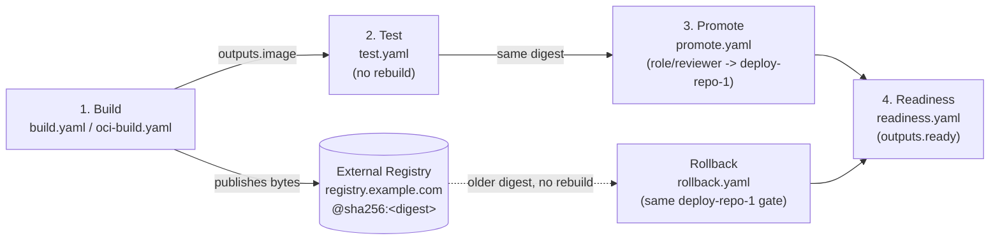

# Delivery Examples

These recipes show how a project builds, tests, promotes, rolls back, and
verifies image bytes from an **external registry** without Kodema owning the
image store.

## Recipe map

| Stage | Pipeline | Purpose |
|---|---|---|
| **1. Build** | [`build.yaml`](../pipelines/build.yaml) / [`oci-build.yaml`](../pipelines/oci-build.yaml) | Build and publish image bytes to `registry.example.com`; emit digest-pinned `image` output (`oci-build.yaml` uses rootless Kaniko with no Docker/Podman socket or `/dev/fuse`). |
| **2. Test** | [`test.yaml`](../pipelines/test.yaml) | Consume the forwarded `image` digest input without rebuilding or republishing. |
| **3. Promote** | [`promote.yaml`](../pipelines/promote.yaml) | Write a deploy-repository work-branch candidate, obtain `role/reviewer` approval on `deploy-repo-1` (`refs/heads/deploy`), and integrate. |
| **Rollback** | [`rollback.yaml`](../pipelines/rollback.yaml) | Promote an older digest through the exact same `deploy-repo-1` / `refs/heads/deploy` approval gate without rebuilding. |
| **4. Readiness** | [`readiness.yaml`](../pipelines/readiness.yaml) | Reconcile and record an explicit post-rollout `ready` observation. |

## Registry ownership

Images live in the external registry `registry.example.com`. Build publishes
bytes there first and then submits a digest-pinned declared output. Every image
reference is pinned as `repository@sha256:<digest>`; a mutable tag is never an
admitted reference.

An image digest is an ordinary output value, not a kodema entity. There is no
artifact table, registration API or catalog: artifacts are strings that point at
external registry bytes. Kodema attributes the exact candidate and digest that a
recipe claims, but the registry owner remains authoritative for publication.

## Promotion

The split recipes keep building separate from promotion:

1. [build](../pipelines/build.yaml) publishes the image digest as the `image`
   output. For an unprivileged Kaniko `Containerfile` build recipe that runs
   without a Docker/Podman socket or `/dev/fuse`, see
   [oci-build](../pipelines/oci-build.yaml) and the
   [unprivileged OCI builds guide](../../docs/runbooks/unprivileged-oci-builds.md).
2. [test](../pipelines/test.yaml) consumes the forwarded `image` input and does
   not republish it.
3. [promote](../pipelines/promote.yaml) writes a deploy-repository work-branch
   candidate and requests approval of the exact ref, expected base and candidate.
4. The approved protected update `git.ref.update` on resource `deploy-repo-1`
   and ref `refs/heads/deploy` is integrated by the third action.

Promotion retries can reuse the recorded digest **without rebuilding**; the
registry pull is idempotent and the submitted output is the same value.

## Rollback

[rollback](../pipelines/rollback.yaml) is a new promotion of an older digest
through the same protected update and the same `deploy-repo-1` /
`refs/heads/deploy` target. It does not rebuild and it never rolls data back
automatically. Both recipes share the deploy target so an operator cannot
silently promote somewhere else.

## Readiness

[readiness](../pipelines/readiness.yaml) records an observed `ready` result.
Command exit is not proof of health: readiness is an observation with its own
outcome, reconciled after rollout.

## Retries, receipts and idempotency

A retried action submits the same receipt and converges on the original result;
idempotency is checked before effects are replayed. A lost output response is
retried with the same digest-pinned value without rebuilding. The factory
receipt proves submission attribution, not independently confirmed publication
or a healthy deployment.

## Unshadowable execution context

The Shell supplies `KODEMA_URL`, `KODEMA_EXECUTION` and `KODEMA_ACTION` (the
current action slug) to every action. `KODEMA_TASK` carries the associated task
ID and is present only when the execution has an associated task; it is unset
for task-free runs such as [plain](../pipelines/plain.yaml). Those names cannot
be declared in pipeline or action env. The execution credential is mounted as
`KODEMA_TOKEN`; stored secret names cannot shadow it and values never appear in
logs, events or receipts.

| Name | Delivery | Scope |
|---|---|---|
| `KODEMA_URL` | Environment variable | Control-plane API base URL reachable from the workload. |
| `KODEMA_EXECUTION` | Environment variable | Current execution ID. |
| `KODEMA_ACTION` | Environment variable | Current action slug. |
| `KODEMA_TASK` | Environment variable | Associated task ID (unset for task-free runs such as `plain.yaml`). |
| `KODEMA_TOKEN` | File (`/kodema/secrets/KODEMA_TOKEN`) | Live execution credential, rotated during long runs and revoked while waiting or terminal. |

## Further reading

- [Examples catalog](../README.md)
- [Unprivileged OCI container builds & workload limits](../../docs/runbooks/unprivileged-oci-builds.md)
- [Context repository skills](../knowledge/README.md)
